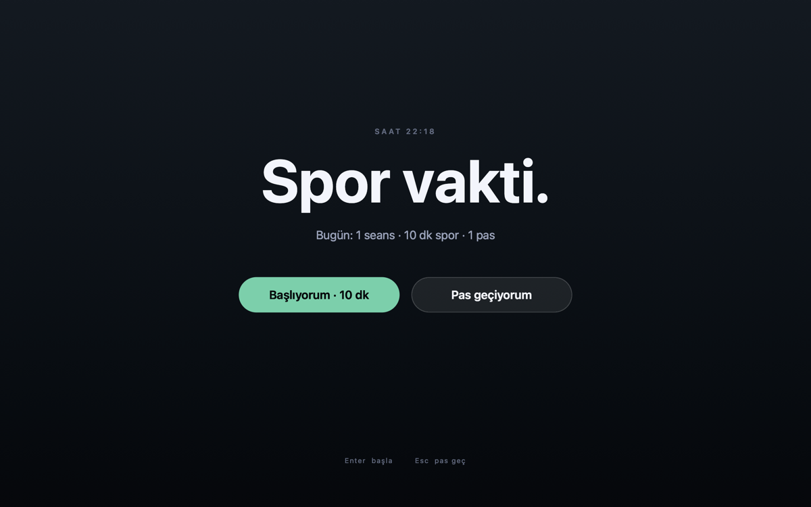
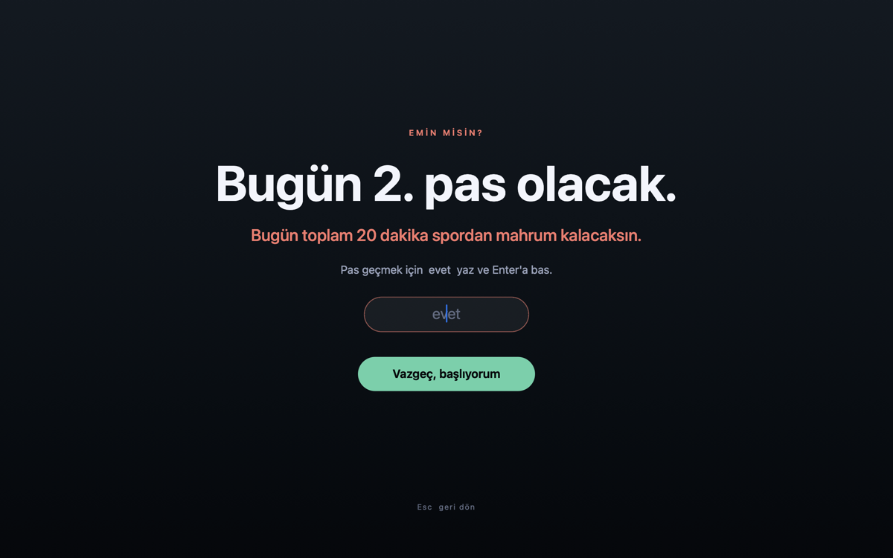
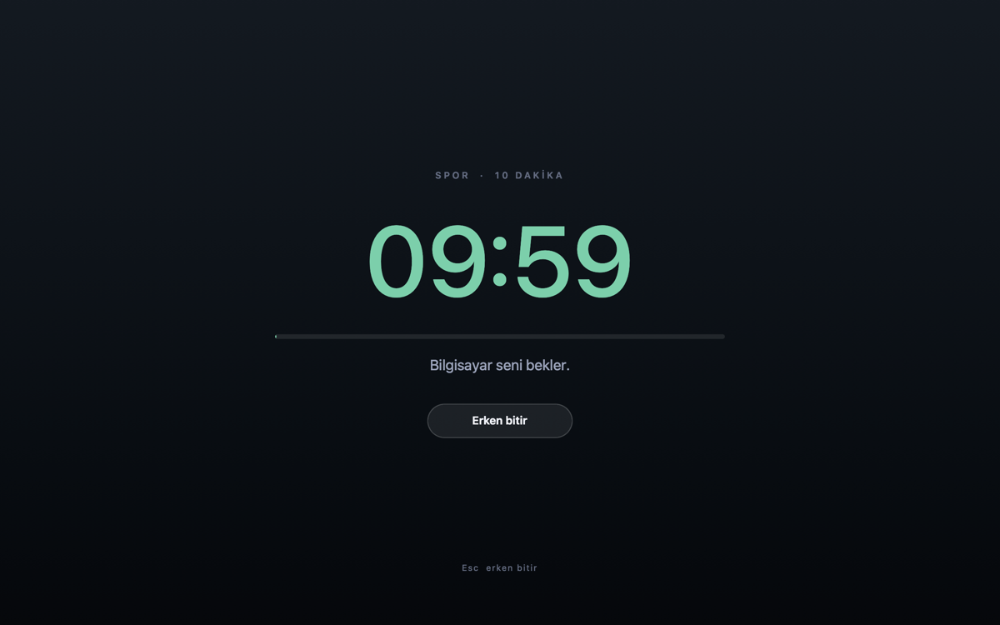
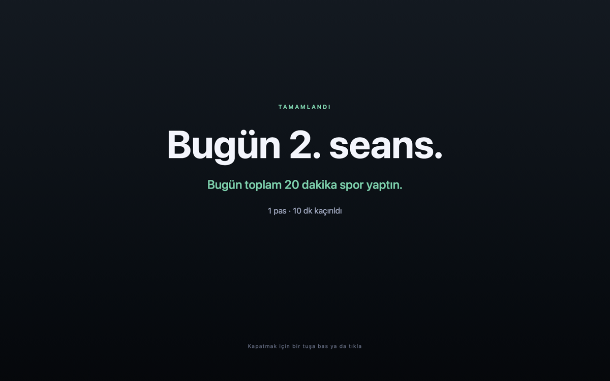
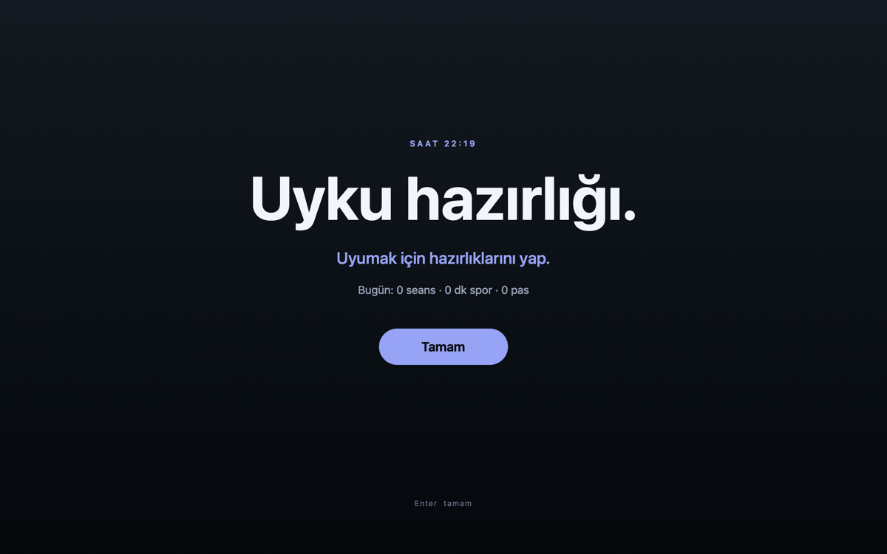
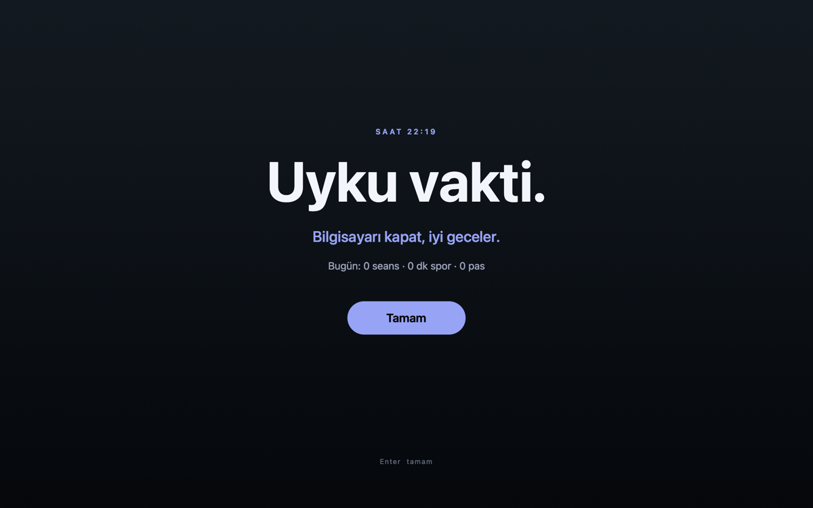
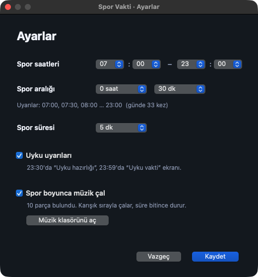

# Spor Vakti

**[Türkçe](#türkçe) · [English](#english)**



---

## Türkçe

Bilgisayar başında saatler geçiyor. **Spor Vakti**, belirlediğin aralıkla (varsayılan: her saat başı) ekranı kaplar ve tek bir şey söyler: *Spor vakti.*

Sana ne yapacağını söylemez. Ama sana sorar: **gerçekten yapıyor musun, yoksa pas mı geçiyorsun?** Pas geçersen o gün kaç kez pas geçtiğini ve kaç dakika spordan mahrum kaldığını söyler. Kaçamak yok.

### İndirdiğinde elinde neler var

- **Hazır spor müziği.** 10 enstrümantal, enerjik parça (her biri yaklaşık 5 dk, toplam 50 dk) uygulamayla birlikte gelir. Spora başladığın an çalmaya başlar, süre bitince kendiliğinden susar. Ayrıca müzik aramana, hesap açmana, internete gerek yok.
- **Kendi ritmin.** Kaç saat kaç dakikada bir spor yapacağını ve her seansın kaç dakika süreceğini ayar ekranından seçersin.
- **Dürüst bir hesap.** Her seans, her pas, kaçırılan her dakika kayda geçer; `rapor.command` son 7 günü gösterir.
- **Doğru anda susar.** Görüşmedeyken, ekran paylaşırken ya da bilgisayar başında değilken araya girmez.

### Nasıl çalışır

| | |
|---|---|
|  | **Belirlediğin saatlerde ve aralıkla (varsayılan 07:00–23:00, saat başı):** Tam ekran "Spor vakti." Bugünkü durumun altta: seans, dakika, pas. Sağ üstteki **Ayarlar** (ya da `A`) ile saatleri, aralığı, süreyi ve müziği oradan değiştirebilirsin; yeni süre hemen geçerli olur. |
| | **Şimdi olmuyorsa:** **5 dk ertele** (ya da `E`). Pas sayılmaz; uyarı 5 dk sonra gelir ve o günün düzeni de 5 dk kayar (14:00 ertelendiyse 14:05, sonraki 15:05). Her erteleme 5 dk daha kaydırır; ertesi gün saat başına döner. |
|  | **Pas geçmek istersen:** "Bugün 2. pas olacak. Bugün toplam 20 dakika spordan mahrum kalacaksın." Kutuya **evet** yazınca **Pas geç** düğmesi açılır. **Spora başla** her zaman orada. |
|  | **Başlıyorum dersen:** Geri sayım başlar (varsayılan 10 dk) ve **spor müziği çalmaya başlar**; süre bitince müzik de yavaşça susar. Erken bitirirsen eksik kalan dakikalar da sayılır. **Küçült · müzik aç** (ya da `M`) ile ekran köşede küçük bir sayaca dönüşür: müzik açabilir, bilgisayarı kullanabilirsin; seans sürer, pas sayılmaz. Süre bitince tam ekran geri gelir. |
|  | **Bitince:** Bugün kaçıncı seans olduğu ve toplam spor süresi. |
|  | **23:30:** "Uyumak için hazırlıklarını yap." (Uyku uyarıları ayarlardan kapatılabilir.) |
|  | **23:59:** "Uyku vakti." Gece uyarıları yalnızca **Tamam** ile kapanır. |

### Ne zaman görünmez

- **Görüşmedeyken:** Bir uygulama mikrofonu kullanıyorsa (Zoom, Google Meet, Teams…) uyarı açılmaz.
- **Ekran paylaşırken:** Zoom paylaşımı ya da Chrome'un paylaşım çubuğu varsa uyarı açılmaz. Pencereler ayrıca ekran yakalamadan hariç tutulacak şekilde işaretlenir. Karşı taraf görmez.
- Ekran kilitliyken, ekran koruyucu açıkken, 10 dakikadan uzun süredir klavye ya da fare kullanılmıyorsa.
- Bilgisayar uykudan geç uyandıysa (uyarı dakikasının üzerinden 5 dakika geçtiyse).
- Spor saatlerinin dışında (varsayılan 07:00–23:00; ayarlardan değişir).
- Duraklatılmışken.

5 dakika içinde cevap verilmezse seans **cevapsız** (pas) sayılır.

### Kurulum

macOS ve Xcode Command Line Tools (`swiftc`) gerekir.

```bash
git clone https://github.com/skagancelik/spor-vakti.git
cd spor-vakti
./kur.command
```

Ya da Finder'da dosyalara çift tıkla:

| Dosya | Ne yapar |
|---|---|
| `kur.command` | Derler, kurar, zamanlayıcıyı başlatır. Güncelleme için de tekrar çalıştır. |
| `deneme.command` | Ekranları dener (20 sn'lik spor + iki gece uyarısı). İstatistiğe yazılmaz. |
| `rapor.command` | Son 7 günün tablosu: seans, spor dakikası, pas, mahrum kalınan dakika. |
| `ayarlar.command` | Ayar ekranı: spor aralığı, spor süresi, müzik. |
| `duraklat.command` | Geçici olarak durdurur / yeniden açar. |
| `kaldir.command` | Kaldırır. Geçmiş verin silinmez. |

### Ayarlar



Spor ekranında sağ üstteki **Ayarlar** düğmesine bas (ya da `A`), veya istediğin zaman `ayarlar.command` dosyasına çift tıkla:

| Ayar | Seçenekler | Varsayılan |
|---|---|---|
| **Spor saatleri** | Başlangıç ve bitiş saati (5 dk adımlarla). Spor uyarıları yalnızca bu saatler arasında gelir. | 07:00 – 23:00 |
| **Spor aralığı** | Kaç saat + kaç dakikada bir (5 dk adımlarla, en az 15 dk). Uyarılar başlangıç saatinden itibaren bu aralıkla tekrar eder: 09:00 ve 1 saat 30 dk → 09:00, 10:30, 12:00… Ekran örnek düzeni ve günde kaç uyarı geleceğini gösterir. | 1 saat |
| **Spor süresi** | 1–60 dakika | 10 dk |
| **Uyku uyarıları** | 23:30 "Uyku hazırlığı" ve 23:59 "Uyku vakti" ekranları: açık / kapalı | Açık |
| **Müzik** | Spor boyunca müzik çal: açık / kapalı | Açık |

Kaydettiğin an geçerli olur; yeniden kurman gerekmez.

### Müzik

Repodaki [`muzik/`](muzik) klasöründe spor için hazırlanmış **10 enstrümantal parça** var. `kur.command` bunları uygulamayla birlikte kurar, yani repoyu indiren herkesin müziği hazırdır.

- Spora başlayınca parçalar **karışık sırayla** çalar; her seans farklı bir parçayla açılır.
- Süre bitince ya da **Erken bitir** dersen ses yavaşça kısılır ve durur.
- **Küçült** ile ekranı köşeye aldığında da müzik çalmaya devam eder.
- **Kendi müziğini eklemek istersen:** ayar ekranındaki **Müzik klasörünü aç** düğmesi hazır parçaların durduğu klasörü (`~/Applications/SporVakti/muzik`) açar. Oraya mp3 ya da m4a at; parçaların hazır listeye karışır. Güncellemede (`kur.command`) eklediklerin silinmez.
- Müzik istemiyorsan ayar ekranından kapat.

Ayarlar `~/Library/Application Support/SporVakti/ayarlar` dosyasında durur. `SPOR_VAKTI_DK` ortam değişkeni seans süresinin önüne geçer.

### Gizlilik

- **İnternete hiç bağlanmaz.** Kodda tek bir ağ çağrısı yok; müzikler de bilgisayarındaki dosyalardan çalar.
- Geçmiş yalnızca kendi bilgisayarında, `~/Library/Application Support/SporVakti/gecmis.csv` içinde durur.
- Mikrofon kontrolü **ses dinlemez.** macOS'a yalnızca "şu an mikrofonu kullanan bir uygulama var mı?" diye sorar.

---

## English

Hours slip by at the desk. **Spor Vakti** ("workout time" in Turkish) takes over your screen on a schedule you choose (by default, every hour) and says just one thing: *Time to move.*

It doesn't tell you what to do. It asks: **are you actually doing it, or skipping?** Skip, and it tells you how many times you've skipped today and how many minutes of exercise you've missed. No hiding.

### What you get out of the box

- **Built-in workout music.** 10 energetic instrumental tracks (about 5 minutes each, 50 minutes in total) ship with the app. They start the moment you start a session and stop on their own when time is up. No streaming service, no account, no internet.
- **Your own rhythm.** Pick how often to move (hours + minutes) and how long each session lasts in the settings window.
- **An honest tally.** Every session, skip and missed minute is logged; `rapor.command` shows the last 7 days.
- **Quiet at the right time.** Stays out of the way during calls, screen sharing, or when you're away from the desk.

### How it works

- **On your schedule (default: every hour, 07:00–23:00):** a full-screen "Spor vakti." prompt with today's tally (sessions, minutes, skips). The **Ayarlar** (Settings) button in the top-right corner (or `A`) opens the settings right there (hours, interval, length, music); a new session length applies immediately.
- **Not now?** **5 dk ertele** (or `E`) snoozes 5 minutes without counting as a skip, and shifts the rest of the day's schedule by 5 minutes too (snooze 14:00 → 14:05, next one at 15:05). Each snooze adds another 5; the next day starts on the hour again.
- **Skip?** A confirmation screen shows the cost ("This will be skip #2 today, 20 minutes missed"). Typing **evet** ("yes") unlocks the **Pas geç** (Skip) button; **Spora başla** (Start) is always there. Your choice is recorded explicitly.
- **Start?** A countdown (10 minutes by default) and **the workout music kicks in**; it fades out when time is up. Ending early still counts the missing minutes. **Küçült · müzik aç** (or `M`) shrinks it to a small corner timer so you can put on music or use the computer; the session keeps running and is not a skip. It returns to full screen when time is up.
- **Done:** today's session count and total exercise time.
- **23:30:** "Get ready for bed." **23:59:** "Bedtime." Night notices close only with **Tamam** (OK), and can be turned off in settings.

### When it stays hidden

- **On a call:** if any app is capturing the microphone (Zoom, Google Meet, Teams…).
- **While screen sharing:** Zoom sharing or Chrome's sharing bar detected. The windows are also excluded from screen capture where supported, so the people you share with don't see the reminder.
- Screen locked, screensaver running, or no keyboard or mouse activity for 10+ minutes.
- Late wake from sleep, outside your workout hours (default 07:00–23:00, set in settings), or paused.

No answer within 5 minutes counts as a skip.

### Install

Requires macOS and Xcode Command Line Tools (`swiftc`).

```bash
git clone https://github.com/skagancelik/spor-vakti.git
cd spor-vakti
./kur.command
```

The `.command` scripts can also be double-clicked in Finder: `kur` (install/update), `deneme` (try the screens, nothing is recorded), `rapor` (7-day report), `ayarlar` (settings), `duraklat` (pause/resume), `kaldir` (uninstall; history is kept).

### Settings


Press **Ayarlar** (or `A`) on the workout prompt, or double-click `ayarlar.command` anytime:

| Setting | Options | Default |
|---|---|---|
| **Workout hours** (Spor saatleri) | Start and end time, 5-minute steps. Workout prompts only appear in this window. | 07:00 – 23:00 |
| **Interval** (Spor aralığı) | Hours + minutes, 5-minute steps, at least 15 min. Prompts repeat from the start time: 09:00 and 1 h 30 min → 09:00, 10:30, 12:00… The window previews the schedule and how many prompts you'll get per day. | 1 hour |
| **Session length** (Spor süresi) | 1–60 minutes | 10 min |
| **Sleep notices** (Uyku uyarıları) | The 23:30 "Get ready for bed" and 23:59 "Bedtime" screens: on / off | On |
| **Music** (Müzik) | Play music during the session: on / off | On |

Changes apply as soon as you save; no reinstall needed.

### Music

The repo's [`muzik/`](muzik) folder holds **10 instrumental workout tracks**. `kur.command` installs them with the app, so everyone who clones the repo gets the music too.

- Tracks play **shuffled** during the session, so each one opens with a different track.
- When time is up, or you end early, the music fades out and stops.
- It keeps playing when you shrink the session to the corner timer.
- **Want your own tracks?** **Müzik klasörünü aç** (Open music folder) in settings opens the folder holding the built-in tracks (`~/Applications/SporVakti/muzik`). Drop mp3 or m4a files there and they join the shuffle. Updates (`kur.command`) keep the files you added.
- Don't want music? Turn it off in settings.

### Privacy

- **No network access at all.** No network code in the codebase; music plays from files on your Mac.
- History stays on your machine only: `~/Library/Application Support/SporVakti/gecmis.csv`.
- The microphone check **never listens to audio.** It only asks macOS whether some app is currently capturing input.

---

## Lisans / License

[MIT](LICENSE)
