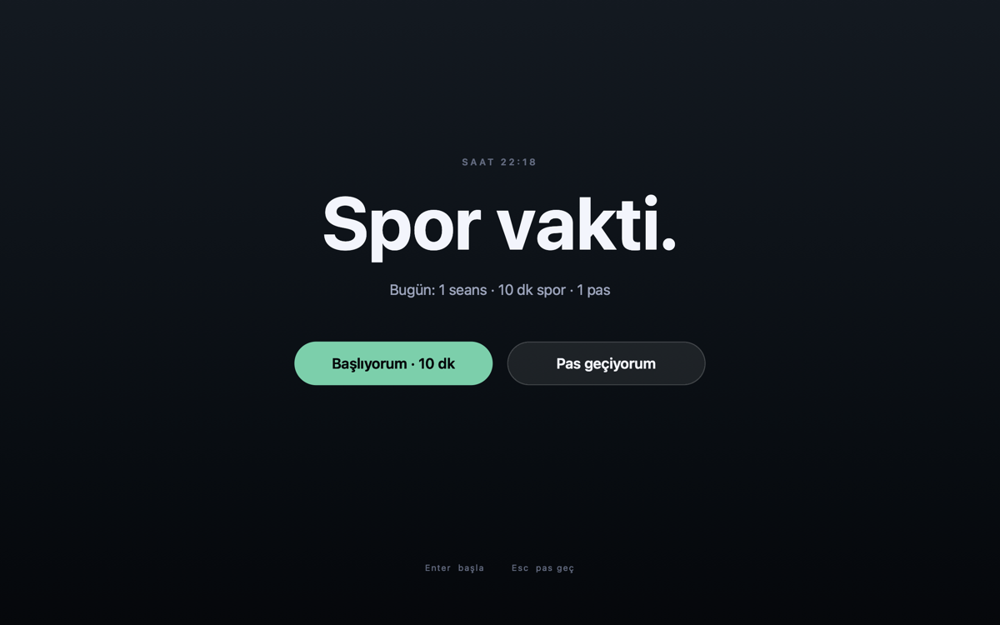
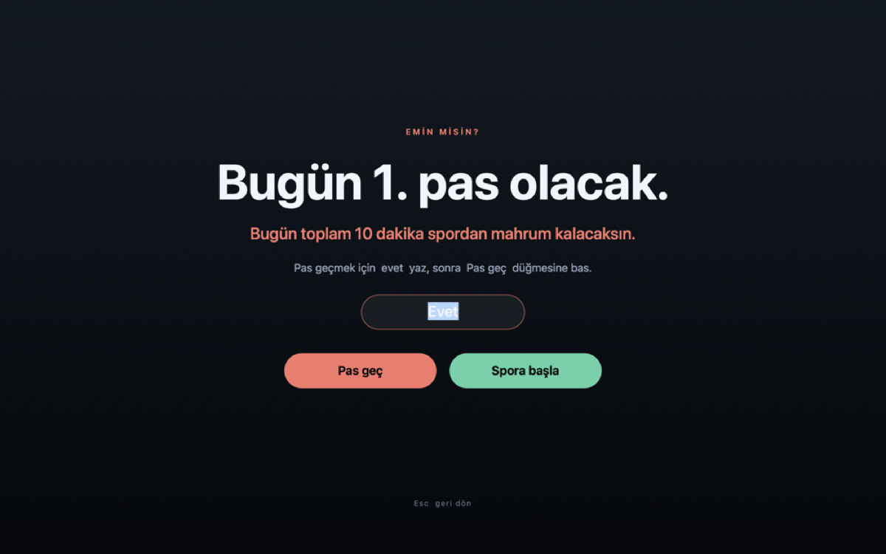
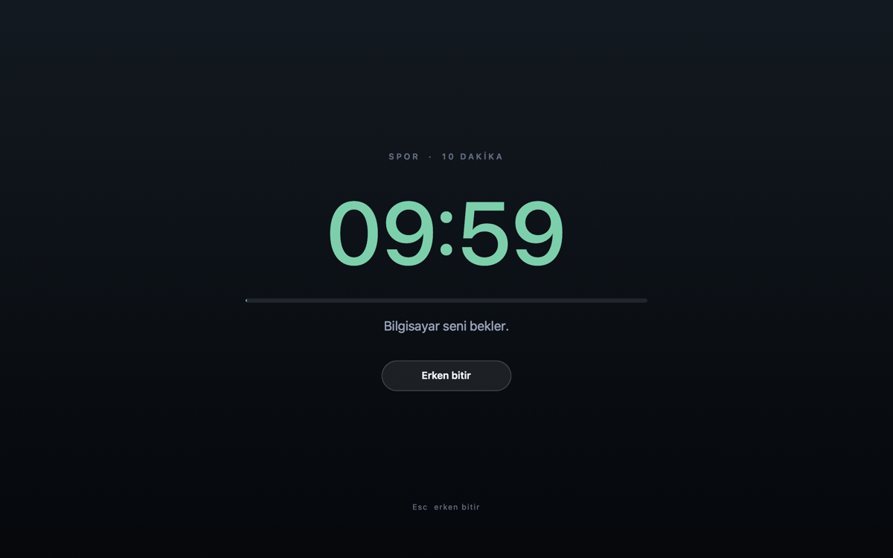
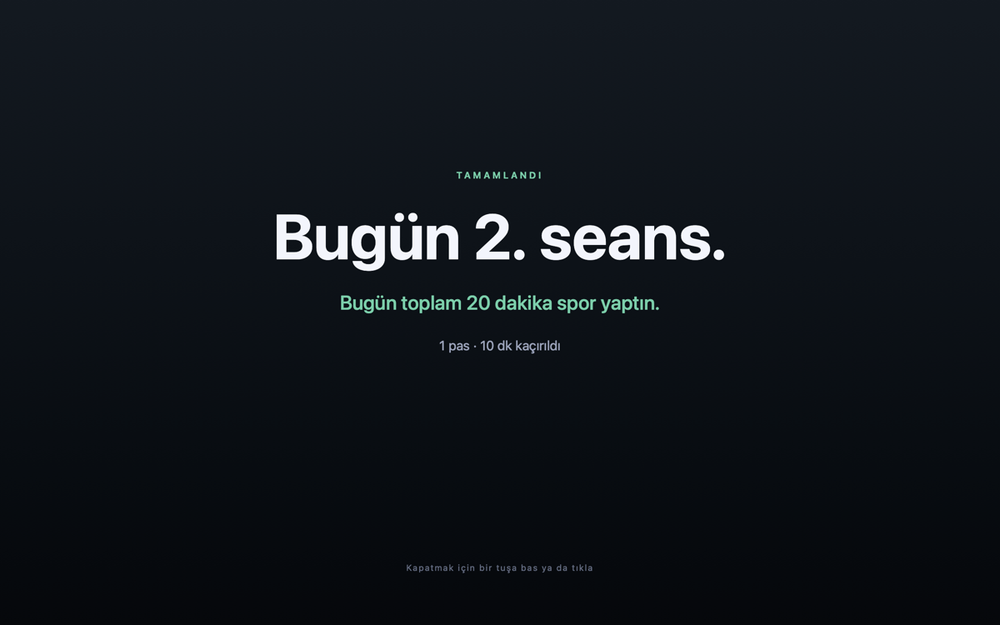
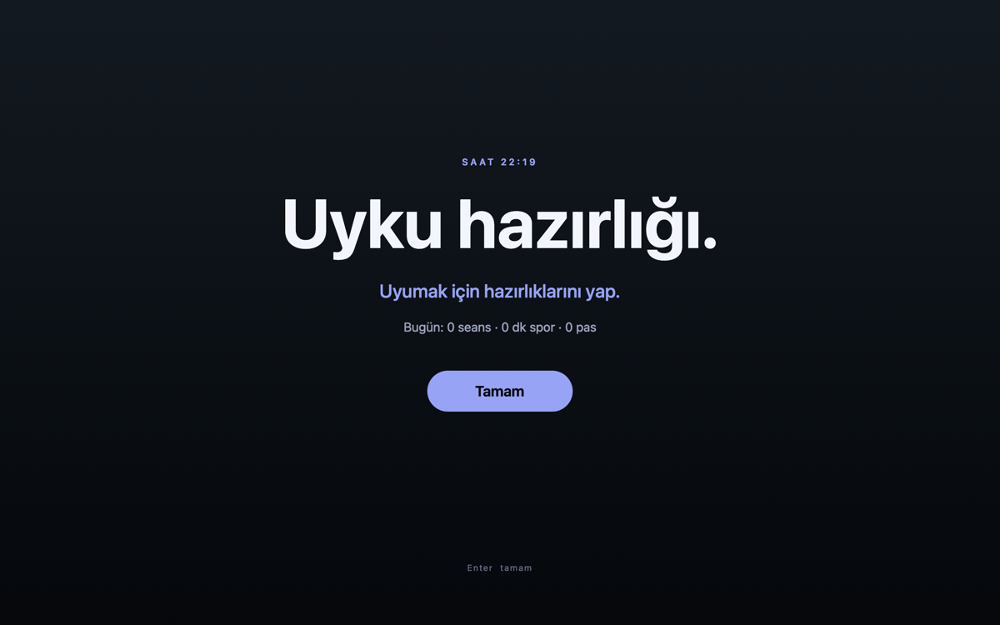
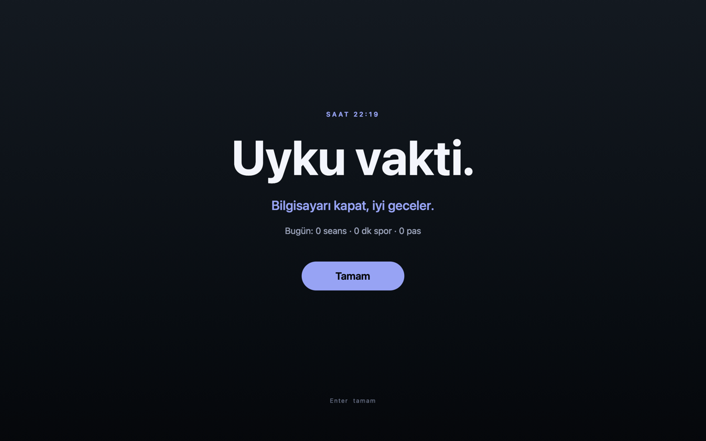

# Spor Vakti

**[Türkçe](#türkçe) · [English](#english)**



---

## Türkçe

Bilgisayar başında saatler geçiyor. **Spor Vakti**, her saat başı ekranı kaplar ve tek bir şey söyler: *Spor vakti.*

Sana ne yapacağını söylemez. Ama sana sorar: **gerçekten yapıyor musun, yoksa pas mı geçiyorsun?** Pas geçersen o gün kaç kez pas geçtiğini ve kaç dakika spordan mahrum kaldığını söyler. Kaçamak yok.

### Nasıl çalışır

| | |
|---|---|
|  | **Saat başı (07:00–23:00):** Tam ekran "Spor vakti." Bugünkü durumun altta: seans, dakika, pas. |
|  | **Pas geçmek istersen:** "Bugün 2. pas olacak. Bugün toplam 20 dakika spordan mahrum kalacaksın." Kutuya **evet** yazınca **Pas geç** düğmesi açılır. **Spora başla** her zaman orada. |
|  | **Başlıyorum dersen:** 10 dakikalık geri sayım. Erken bitirirsen eksik kalan dakikalar da sayılır. |
|  | **Bitince:** Bugün kaçıncı seans olduğu ve toplam spor süresi. |
|  | **23:30:** "Uyumak için hazırlıklarını yap." |
|  | **23:59:** "Uyku vakti." Gece uyarıları yalnızca **Tamam** ile kapanır. |

### Ne zaman görünmez

- **Görüşmedeyken:** Bir uygulama mikrofonu kullanıyorsa (Zoom, Google Meet, Teams…) uyarı açılmaz.
- **Ekran paylaşırken:** Zoom paylaşımı ya da Chrome'un paylaşım çubuğu varsa uyarı açılmaz. Pencereler ayrıca ekran yakalamadan hariç tutulacak şekilde işaretlenir. Karşı taraf görmez.
- Ekran kilitliyken, ekran koruyucu açıkken, 10 dakikadan uzun süredir klavye ya da fare kullanılmıyorsa.
- Bilgisayar uykudan geç uyandıysa (saatin ilk 10 dakikası geçtiyse).
- Gece 00:00–07:00 arası spor uyarısı yok.
- Duraklatılmışken.

5 dakika içinde cevap verilmezse seans **cevapsız** (pas) sayılır.

### Kurulum

macOS ve Xcode Command Line Tools (`swiftc`) gerekir.

```bash
git clone https://github.com/skagancelik/spor-vakti.git
cd spor-vakti
./kur.command
```

Ya da Finder'da dosyalara çift tıkla:

| Dosya | Ne yapar |
|---|---|
| `kur.command` | Derler, kurar, zamanlayıcıyı başlatır. Güncelleme için de tekrar çalıştır. |
| `deneme.command` | Ekranları dener (20 sn'lik spor + iki gece uyarısı). İstatistiğe yazılmaz. |
| `rapor.command` | Son 7 günün tablosu: seans, spor dakikası, pas, mahrum kalınan dakika. |
| `duraklat.command` | Geçici olarak durdurur / yeniden açar. |
| `kaldir.command` | Kaldırır. Geçmiş verin silinmez. |

### Ayarlar

- Seans süresi varsayılan **10 dakika**. Değiştirmek için `SPOR_VAKTI_DK` ortam değişkenini kullan.
- Saatler `kur.command` içindeki LaunchAgent tanımında, kurallar `scripts/run.sh` içinde.

### Gizlilik

- **İnternete hiç bağlanmaz.** Kodda tek bir ağ çağrısı yok.
- Geçmiş yalnızca kendi bilgisayarında, `~/Library/Application Support/SporVakti/gecmis.csv` içinde durur.
- Mikrofon kontrolü **ses dinlemez.** macOS'a yalnızca "şu an mikrofonu kullanan bir uygulama var mı?" diye sorar.

---

## English

Hours slip by at the desk. **Spor Vakti** ("workout time" in Turkish) takes over your screen at the top of every hour and says just one thing: *Time to move.*

It doesn't tell you what to do. It asks: **are you actually doing it, or skipping?** Skip, and it tells you how many times you've skipped today and how many minutes of exercise you've missed. No hiding.

### How it works

- **Every hour (07:00–23:00):** a full-screen "Spor vakti." prompt with today's tally (sessions, minutes, skips).
- **Skip?** A confirmation screen shows the cost ("This will be skip #2 today, 20 minutes missed"). Typing **evet** ("yes") unlocks the **Pas geç** (Skip) button; **Spora başla** (Start) is always there. Your choice is recorded explicitly.
- **Start?** A 10-minute countdown. Ending early still counts the missing minutes.
- **Done:** today's session count and total exercise time.
- **23:30:** "Get ready for bed." **23:59:** "Bedtime." Night notices close only with **Tamam** (OK).

### When it stays hidden

- **On a call:** if any app is capturing the microphone (Zoom, Google Meet, Teams…).
- **While screen sharing:** Zoom sharing or Chrome's sharing bar detected. The windows are also excluded from screen capture where supported, so the people you share with don't see the reminder.
- Screen locked, screensaver running, or no keyboard or mouse activity for 10+ minutes.
- Late wake from sleep, quiet hours (00:00–07:00 for workout prompts), or paused.

No answer within 5 minutes counts as a skip.

### Install

Requires macOS and Xcode Command Line Tools (`swiftc`).

```bash
git clone https://github.com/skagancelik/spor-vakti.git
cd spor-vakti
./kur.command
```

The `.command` scripts can also be double-clicked in Finder: `kur` (install/update), `deneme` (try the screens, nothing is recorded), `rapor` (7-day report), `duraklat` (pause/resume), `kaldir` (uninstall; history is kept).

Session length defaults to **10 minutes**. Override it with the `SPOR_VAKTI_DK` environment variable.

### Privacy

- **No network access at all.** No network code in the codebase.
- History stays on your machine only: `~/Library/Application Support/SporVakti/gecmis.csv`.
- The microphone check **never listens to audio.** It only asks macOS whether some app is currently capturing input.

---

## Lisans / License

[MIT](LICENSE)
